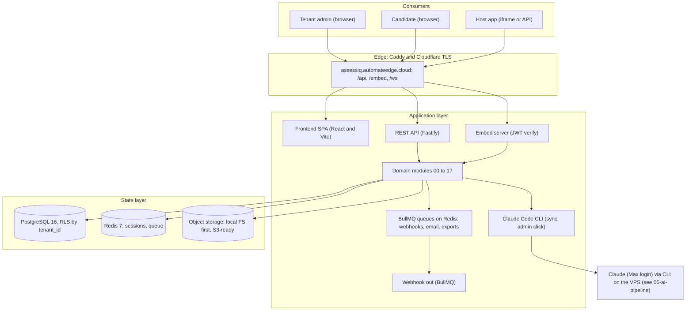
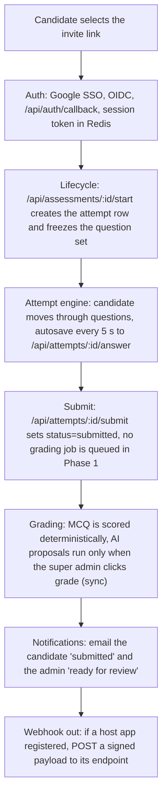
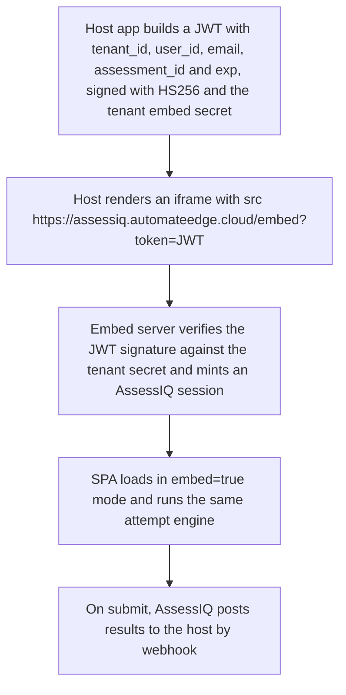

# 01 — Architecture overview

*Type: explanation* — This page explains the system context, the user classes and how the parts fit together.

## Why it is built this way

- **One VPS first.** One Docker host is enough for the first load. The design keeps a clear path to more servers.
- **Isolation in the database.** Every domain table carries `tenant_id` and a row-level security (RLS) policy. A bug in application code cannot read the rows of another customer.
- **AI grading on admin click.** An admin starts each AI grading run, and the run is synchronous. No background worker calls the AI. This rule limits cost and ties each grade to a person.
- **Queues for non-AI work only.** BullMQ (a Redis job queue) sends email, webhooks and exports. It never runs AI grading in Phase 1.
- **Host apps trust a signature.** An embedding application proves a candidate identity with a signed token. AssessIQ trusts the signature, not the page that holds the frame.

## System context

AssessIQ has three classes of users and three modes of access:

- Tenant admin: a manager in a customer organisation. Access is through a browser.
- Candidate: a person who takes an assessment. Access is through a browser.
- Host app: an application that embeds AssessIQ. Access is through an iframe or the API.

## Component responsibilities

### Edge: Caddy and Cloudflare

- **Cloudflare** ends public TLS. It also gives the managed certificate, the WAF, rate limiting and the orange-cloud proxy.
- **Caddy** (`ti-platform-caddy-1`) is shared with other apps on the VPS. It handles origin TLS, HTTP/2, gzip/zstd and split-route proxying.
- Authenticated Origin Pulls (AOP, `mode require_and_verify`) and the app-layer `x-origin-verify` header lock the origin to Cloudflare. See `docs/06-deployment.md`, section "Authenticated Origin Pulls (AOP)".
- Caddy sends `/api/*`, `/embed*`, `/help/*` and `/take/start` to `assessiq-api:3000` on the internal network.
- Caddy sends all other paths to `assessiq-frontend:80` (host port 9091).
- Caddy upgrades WebSocket requests for `/ws` (live grading-status updates).
- `docs/06-deployment.md` has the Caddyfile block and the VPS topology.

### Frontend SPA: React 19 and Vite 8

- The SPA has two route trees: `/admin/*` and `/take/*`.
- The URL flag `?embed=true` turns on embed mode. Embed mode removes the top navigation and applies theme overrides.
- The SPA talks only to `/api/*` over fetch and WebSocket.
- UI copy is English only and is hard-coded in the components. An i18n layer is an open owner decision (RW-42).

### REST API: Fastify

- The API is stateless and scales horizontally.
- One image runs two containers. `assessiq-api` serves requests. `assessiq-worker` runs the BullMQ scheduler and non-AI jobs (`src/worker.ts`).
- Both containers bind-mount the host `claude` CLI and `/root/.claude` (`infra/docker-compose.yml`).
- The worker must never call the CLI. This is the "no ambient AI" rule. `modules/07-ai-grading/ci/lint-no-ambient-claude.ts` enforces it.
- Modules join the API as Fastify plugins with explicit dependency declarations.
- A request follows this path: `Cloudflare → Caddy → fastify → auth middleware → tenant context → module handler → repository → postgres`.

### Grading: Phase 1 uses the Claude Code CLI, Phase 2 uses the Claude Agent SDK

- **Phase 1 (current).** An admin click starts grading. Grading runs synchronously through the Claude Code CLI on the VPS. BullMQ is not used, and no `grading:queue` exists. See `docs/05-ai-pipeline.md` and `CLAUDE.md` rule #1.
- **Phase 2 (designed, not live).** `AI_PIPELINE_MODE=anthropic-api` selects an async BullMQ worker with the Claude Agent SDK. Only `modules/07-ai-grading/src/runtimes/anthropic-api.ts` may import the SDK (checked with `git grep`). Phase 1 is the live default (`claude-code-vps`, `docs/05-ai-pipeline.md` lines 11-14).
- A job is idempotent. It uses `attempt_id + prompt_version` as the dedup key, so the same job can run again safely.
- `docs/05-ai-pipeline.md` has the full grading flow and the difference between Phase 1 and Phase 2.

### State layer

- **PostgreSQL 16** is a single primary with daily logical backups offsite. The `tenant_id` column on every domain table and RLS policies (set through session variables) isolate tenants.
- **Redis 7** has three purposes:
  1. Session store (admin TOTP sessions and candidate attempt sessions).
  2. BullMQ queue (webhooks and email; the grading queue is active in Phase 2 only).
  3. Rate limit counters (per IP, per tenant, per API key).
- **Object storage** is the local filesystem at `/var/assessiq/uploads` at first. The schema is S3-compatible. Change the driver in the env when you move to S3.

## Data flow: taking an assessment

For the grading step, see `docs/05-ai-pipeline.md`.

## Data flow: embed in a host app

The host app polls `/api/embed/attempts/:id` for status, or registers a webhook URL. <!-- verify: docs/09-integration-guide.md section 6 says no polling endpoint exists in v1 -->

## Concurrency and scale model

| Concern | v1 (single VPS) | v2 (when needed) |
| --- | --- | --- |
| API requests | One `assessiq-api` Docker container (tsx, `infra/docker/assessiq-api/Dockerfile`); no PM2 | Add API replicas behind an nginx upstream |
| Grading | Sync on admin click through the Claude Code CLI; single-flight; no worker queue | Phase 2 async workers (`AI_PIPELINE_MODE=anthropic-api`) |
| Database | Single Postgres, connection pool through PgBouncer | Read replicas for reporting queries |
| Cache | Single Redis | Redis Cluster or Sentinel for high availability |
| LLM calls | Claude Code CLI on the VPS (Max login), not the API | Monitor prompt-cache hits; consider Bedrock for cost |

The single-VPS deployment handles about 50 concurrent attempts and about 100 grading jobs each hour. That is more than 1000 assessments each week. This is enough for the SOC team and several other internal teams.

## Security posture

- **Defense in depth.** The layers are TLS at the edge, JWT for embed, session cookies for the SPA (HTTP-only, Secure, SameSite=Lax), API keys for back-end calls and RLS in the database.
- **Tenant isolation.** Every query carries `tenant_id`. RLS policies block cross-tenant reads even when application code has a bug.
- **Secret management.** v1 uses `.env` (a read-only file owned by the service user). v2 moves to Vault or Doppler.
- **Audit.** The system logs every admin action append-only, with actor, before and after state, IP and user agent. See `14-audit-log`.
- **Data residency.** The Hostinger VPS region matters. For Wipro use, choose an India region and check DPDP Act compliance.
- **AI data handling.** In Phase 1, candidate answers go to Claude through the Claude Code CLI for grading. Tell each tenant at onboarding. The Anthropic data retention policy applies. For sensitive content in v2, consider Bedrock in your own AWS account.

## Not in scope for v1

- On-prem deployment (Phase 4 or later, if a client needs it).
- BYO-LLM or model selection per tenant.
- Live proctoring (webcam or screen recording, which creates a data-loss-prevention problem).
- Mobile app (the web app is mobile-responsive; a native app is deferred).
- Real-time collaborative grading (one reviewer for each attempt).
- Marketplace for question packs (single-tenant authoring only).

## Reference (moved later)

> This section holds reference tables that belong on a reference page. `docs/06-deployment.md` has the deployment topology.

### Docker services (actual topology)

From `infra/docker-compose.yml`. All services use the network `assessiq-net`.

| Container | Role | Source |
| --- | --- | --- |
| `assessiq-postgres` | PostgreSQL 16 (RLS by `tenant_id`) | `postgres:16-alpine` |
| `assessiq-redis` | Redis 7: sessions, rate limits, BullMQ | `redis:7-alpine` |
| `assessiq-api` | Fastify API (`tsx src/server.ts`); runs sync AI grading through the mounted `claude` CLI | `infra/docker/assessiq-api/Dockerfile` |
| `assessiq-worker` | Same image as api; `src/worker.ts` runs BullMQ jobs (non-AI) | `infra/docker-compose.yml` |
| `assessiq-frontend` | nginx that serves the React SPA | `infra/docker/assessiq-frontend/Dockerfile` |
| `assessiq-marketing` | nginx that serves the marketing site | `infra/docker/assessiq-marketing/Dockerfile` |

PM2 is not used. Cloudflare and the shared Caddy (`ti-platform-caddy-1`) sit in front (see `docs/06-deployment.md`).

*Last verified: 2026-10-02 against `infra/docker-compose.yml`, `infra/docker/*/Dockerfile`, `docs/05-ai-pipeline.md`, `docs/06-deployment.md`. Sections not listed (data flows, security posture, scope) were not re-verified.*

## Related pages

- [Data model](02-data-model.md)
- [API contract](03-api-contract.md)
- [Authentication flows](04-auth-flows.md)
- [AI pipeline](05-ai-pipeline.md)
- [Deployment](06-deployment.md)
- [Observability](11-observability.md)
- [Integration guide](09-integration-guide.md)
