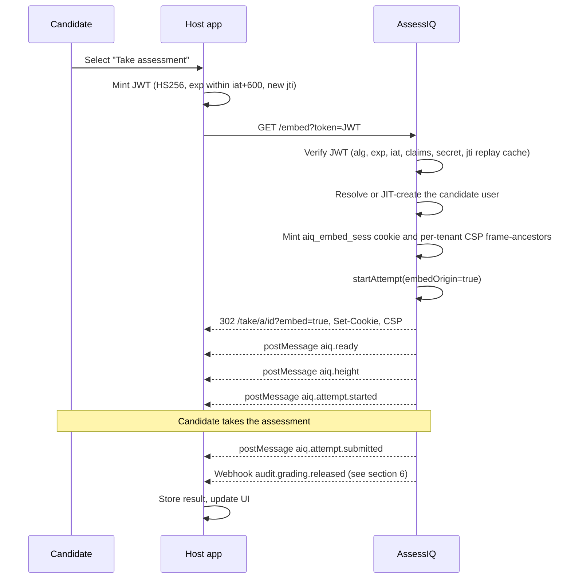

# 09 — Integration guide

*Type: how-to* — This page gives the steps for a host-app engineer to embed an assessment with a signed token.

> **Audience:** a host-app engineer who knows JWT, HTTPS and iframe basics. You do not need AssessIQ internals.
> For the AssessIQ-side implementation, see `modules/12-embed-sdk/SKILL.md`.

## 1. Overview

Goal: run an assessment inside your application iframe. The candidate stays in your product.

- Your backend mints a short-lived signed JWT. The JWT states the candidate identity.
- AssessIQ verifies the signature, creates or resumes the candidate account, and serves the assessment in the frame.
- **Trust boundary:** your app vouches for the candidate through the JWT signature. AssessIQ trusts the signature, not the iframe origin.
- The embed surface covers candidate-take only: the `/embed` and `/take/*` routes. An embed session cannot reach admin views, results pages or reviewer surfaces (frozen decision D1, `modules/12-embed-sdk/SKILL.md:89`).
- Typical integrators are HR portals, LMS platforms and custom HRMS products.

---

## 2. Prerequisites

Complete every item before you start step 3.

| Prerequisite | How to complete it |
| --- | --- |
| AssessIQ tenant with admin access | Provision it in the AssessIQ admin, or ask your account manager |
| Privacy disclosure confirmed | Go to Settings → Integrations → Privacy. You must do this before you create embed secrets (D13; `apps/api/src/routes/auth/embed-secrets.ts:71`) |
| Embed secret provisioned | Go to Settings → Integrations → Embed Secrets → New (`POST /api/admin/embed-secrets`) |
| Host origin allow-listed | Go to Settings → Integrations → Embed Origins (`POST /api/admin/embed-origins`) |
| Pack, level and published assessment | Use the AssessIQ admin authoring flow. The assessment must be published before the embed can start it |
| HTTPS on the host app domain | Required. `SameSite=None; Secure` cookies and JWT delivery both need TLS |

1. Store the embed secret in your backend secret manager.
2. Copy the secret when you create it. AssessIQ shows it once and never returns it again (`apps/api/src/routes/auth/embed-secrets.ts:95–96`).

---

## 3. Mint the token

Your backend creates one JWT for each iframe load.

1. Build a payload with the claims in the table below.
2. Sign the payload with HS256 and the embed secret.
3. Set `exp` to at most `iat + 600` seconds.
4. Set a new `jti` for each token.

### Claim table

| Claim | Type | Required | Description | Example |
| --- | --- | --- | --- | --- |
| `iss` | `string` | no | Issuer label that names your service. Any string. | `"wipro-portal"` |
| `aud` | `string` | no | Must equal `"assessiq"` when present. Recommended. | `"assessiq"` |
| `sub` | `string` | **yes** | Stable user identifier in your system. Stored as `users.metadata.external_id`. Rejection test: T5b (`embed-verify.test.ts:220`) | `"emp-42315"` |
| `tenant_id` | `string` (UUID) | **yes** | Your AssessIQ tenant UUID. It scopes the whole request. Rejection test: T5a (`embed-verify.test.ts:216`) | `"019c8d7e-0001-7f00-8000-wipro0000001"` |
| `email` | `string` | **yes** | Candidate email. AssessIQ uses it to find or JIT-create the user. AssessIQ normalises it with `lower().trim()`. Rejection test: T5c (`embed-verify.test.ts:224`) | `"alice@wipro.com"` |
| `name` | `string` | **yes** | Candidate display name. | `"Alice Sharma"` |
| `assessment_id` | `string` (UUID) | **yes** | UUID of the published assessment to start. Rejection test: T5d (`embed-verify.test.ts:228`) | `"019c8d7e-face-7f00-8000-assess000001"` |
| `exp` | `number` | **yes** | Expiry in Unix **seconds**. The maximum is `iat + 600`. AssessIQ rejects longer tokens before any DB call (D5, V3 `embed-verify.test.ts:118`). | `1715444400` |
| `iat` | `number` | **yes** | Issued-at in Unix seconds. It must not be more than 5 s in the future (clock-skew tolerance). Rejection test: T4 (`embed-verify.test.ts:167`) | `1715443800` |
| `jti` | `string` | **yes** | Unique token ID. AssessIQ burns it in Redis on first use. A replay with the same `jti` returns 401 (T8, `embed-jwt-db.test.ts:383`). Use `crypto.randomUUID()`. | `"550e8400-e29b-41d4-a716-446655440000"` |
| `external_id` | `string` | no | Your HR or employee ID. Webhook payloads echo it as `user.external_id` for reconciliation (D9, `SKILL.md:359`) | `"EMP-12345"` |

**Source for the required-claim list:** `modules/12-embed-sdk/src/__tests__/embed-verify.test.ts:196–234` (T5a–T5d). The payload shape is in `embed-jwt-db.test.ts:143–156`.

**Algorithm.** Use HS256 only. AssessIQ rejects `alg=none` and RS256 before any DB call (V1, V2; `embed-verify.test.ts:73–115`). Frozen decision D5 (`SKILL.md:214`).

**Maximum lifetime.** `exp − iat` must be 600 seconds or less. Longer tokens fail pre-DB validation (`embed-verify.test.ts:118–135`). The token is single-use, so keep `exp` short. The session minted from the token lasts up to 8 hours, whatever the token expiry (D6, `session-mint.ts:31`).

### Node.js minting snippet

```js
import jwt from "jsonwebtoken";
import { randomUUID } from "crypto";

function mintAssessIQEmbedToken({ tenantId, user, assessmentId }) {
  const now = Math.floor(Date.now() / 1000);      // Unix seconds — NOT milliseconds
  return jwt.sign(
    {
      iss: "your-app-name",
      aud: "assessiq",
      sub: String(user.id),                        // your stable user ID
      tenant_id: tenantId,                         // AssessIQ tenant UUID
      email: user.email,
      name: user.fullName,
      external_id: user.employeeId,                // optional — echoed in webhooks
      assessment_id: assessmentId,
      iat: now,
      exp: now + 600,                              // max 600 s; single-use token
      jti: randomUUID(),                           // unique per mint; burned on first use
    },
    process.env.AIQ_EMBED_SECRET,
    { algorithm: "HS256" }
  );
}
```

### Check the token with curl

1. Mint a token with the snippet above.
2. Run this command:

   ```bash
   curl -v "https://assessiq.in/embed?token=${TOKEN}"
   ```

3. Check for these results:
   - `HTTP 302` to `/take/a/<attemptId>?embed=true`.
   - `Set-Cookie: aiq_embed_sess=…; SameSite=None; Secure; HttpOnly; Path=/`.
   - `Content-Security-Policy: frame-ancestors https://yourapp.com`.

---

## 4. Load the iframe

1. Mint a token when the candidate opens the page. Do not mint it at login.
2. Render `<iframe src="https://assessiq.in/embed?token=<JWT>" allow="fullscreen">`.
3. Listen for `postMessage` events from AssessIQ (see "postMessage protocol" below).
4. Resize the iframe when you receive `aiq.height`.
5. Hide or replace the iframe after you receive `aiq.attempt.submitted`.

The following diagram shows the full exchange.



**Steps inside `GET /embed` (`apps/api/src/routes/auth/embed.ts:35–108`):**

1. The route checks that the `token` query parameter exists. If it is missing, the route returns 400 `MISSING_TOKEN` (`embed.ts:44–48`).
2. `verifyEmbedToken(token)` rejects a bad alg, an expired token, a future iat, a missing claim, a wrong secret or a replayed jti. It returns 401 `INVALID_TOKEN` (`embed.ts:51–58`).
3. `getEmbedOrigins(tenantId)` and `buildEmbedCsp(origins)` set `Content-Security-Policy: frame-ancestors <origins>` and remove `X-Frame-Options` (`embed.ts:63–69`).
4. `resolveJitUser()` finds the user by email or creates a `role='candidate'` user (`embed.ts:72–77`).
5. `mintEmbedSession()` writes a `sessions` row with `session_type='embed'` and sets the cookie (`embed.ts:80–96`).
6. `startAttempt({ embedOrigin: true })` is idempotent. It returns the existing attempt if one runs (`embed.ts:99–103`).
7. The route sends a `302` redirect to `/take/a/<attemptId>?embed=true` (`embed.ts:107`).

**Cookie attributes** (`session-mint.ts:6–13`):

| Attribute | Value | Reason |
| --- | --- | --- |
| Name | `aiq_embed_sess` | Differs from `aiq_sess` to prevent scope bleed (D6) |
| `SameSite` | `None` | Required in a third-party iframe context (D7) |
| `Secure` | true | Browsers require it when `SameSite=None` |
| `HttpOnly` | true | Reduces XSS risk |
| `Path` | `/` | None |
| `Max-Age` | `min(jwtExp − now, 28800)` | 8-hour hard cap. The cookie never outlives the JWT credential (`session-mint.ts:63–64`) |

### postMessage protocol

**AssessIQ → host.** Subscribe with `window.addEventListener("message", …)`.

| `type` | Additional fields | When | Notes |
| --- | --- | --- | --- |
| `aiq.ready` | `tenantId: string`, `assessmentId: string` | The SPA is mounted and the session is verified | Sent to `targetOrigin: '*'`. It holds no secrets because the host origin is not yet confirmed (`embedBus.ts:80`) |
| `aiq.height` | `height: number` | Every body-height change (ResizeObserver) | The field name is `height`. Use `msg.height + "px"` to resize the iframe |
| `aiq.attempt.started` | `attemptId: string` | The attempt moves to `in_progress` | SKILL.md D3 |
| `aiq.attempt.submitted` | `attemptId: string`, `summary: { questions: number, time_used_seconds: number }` | The candidate submits | The result is released later; see § 6 |
| `aiq.error` | `code: "SESSION_EXPIRED"\|"ATTEMPT_NOT_FOUND"\|"NETWORK_ERROR"\|"UNKNOWN"`, `message: string` | A user-actionable error in the iframe | SKILL.md D3 |
| `aiq.close-blocked` | `reason: "attempt_in_progress"` | Reply to the host `aiq.close-request` when an attempt is live | SKILL.md D3 |

**Host → AssessIQ.** Send with `iframe.contentWindow.postMessage(msg, "https://assessiq.in")`.

| `type` | Additional fields | Effect |
| --- | --- | --- |
| `aiq.theme` | `tokens: Record<string, string>` | Runtime CSS overrides. Keys must match `/^--aiq-[a-z][a-z0-9-]*$/`. AssessIQ drops other keys without a message (D2, `csp-builder.ts:34`) |
| `aiq.locale` | `locale: "en" \| "en-IN" \| "hi-IN"` | Changes the display language. An unknown locale falls back to `"en"` |
| `aiq.close-request` | none | Requests an iframe close. AssessIQ replies `aiq.close-blocked` if an attempt is in progress |

**Minimal postMessage handler:**

```js
const aiqOrigin = "https://assessiq.in";

window.addEventListener("message", (e) => {
  if (e.origin !== aiqOrigin) return;         // always verify origin
  const msg = e.data;
  if (!msg?.type) return;

  switch (msg.type) {
    case "aiq.height":
      iframe.style.height = msg.height + "px"; // field name is `height`
      break;
    case "aiq.attempt.submitted":
      // the result is released later — see § 6 for the webhook events delivered today
      showToast(`Submitted (attempt ${msg.attemptId})`);
      break;
    case "aiq.error":
      handleEmbedError(msg.code, msg.message);
      break;
    case "aiq.close-blocked":
      showConfirmDialog("A test is in progress. Leave anyway?");
      break;
  }
});
```

### Optional: use the SDK

**npm package** (`packages/embed-sdk/src/index.ts:89–162`):

```bash
npm install @assessiq/embed
```

```js
import { AssessIQEmbed } from "@assessiq/embed";

const embed = AssessIQEmbed.mount("#assessment-container", {
  token: await fetchTokenFromYourBackend(),
  onReady:  () => console.log("loaded"),
  onSubmit: (e) => console.log("submitted", e.attemptId),
  onError:  (e) => console.error(e.code, e.message),
});
// later: embed.destroy()
```

**CDN or no-build alternative:**

```html
<script src="https://assessiq.in/embed/sdk.js"></script>
<script>
  window.AssessIQ.mount("#container", { token: "..." });
</script>
```

`GET /embed/sdk.js` serves a self-contained UMD bundle (3 KB or less, `Cache-Control: public, max-age=3600`). Source: `apps/api/src/routes/auth/embed.ts:123`.

---

## 5. Handle errors

### `GET /embed?token=<JWT>` entry-point errors

All 401 errors from JWT verification use the code `INVALID_TOKEN`. The `message` field tells them apart (`embed.ts:53–57`).

| Condition | HTTP | `error.code` | JSON body | Recovery | Host or AssessIQ bug? |
| --- | --- | --- | --- | --- | --- |
| `token` param absent | 400 | `MISSING_TOKEN` | `{"error":{"code":"MISSING_TOKEN","message":"token query param required"}}` | Make sure the iframe `src` includes `?token=…` | Host bug |
| JWT malformed or unparseable | 401 | `INVALID_TOKEN` | `{"error":{"code":"INVALID_TOKEN","message":"…"}}` | Pass the raw JWT string, not a base64-encoded or URL-decoded string | Host bug |
| Algorithm not HS256 | 401 | `INVALID_TOKEN` | Same 401 shape | Pass `{ algorithm: "HS256" }` to `jwt.sign()` | Host bug |
| Missing required claim | 401 | `INVALID_TOKEN` | Same 401 shape | Check that all required claims in the § 3 claim table are present | Host bug |
| Token expired (`exp ≤ now`) | 401 | `INVALID_TOKEN` | Same 401 shape | Mint a fresh token just before you render the iframe | Host bug |
| `exp − iat > 600 s` | 401 | `INVALID_TOKEN` | Same 401 shape | Reduce the token lifetime to 600 s or less | Host bug |
| `iat` more than 5 s in the future | 401 | `INVALID_TOKEN` | Same 401 shape | Sync the server clock (NTP). Set `iat = Math.floor(Date.now()/1000)` | Host bug |
| Wrong embed secret | 401 | `INVALID_TOKEN` | Same 401 shape | Use the active embed secret of this tenant | Host bug |
| Token replayed (same `jti`) | 401 | `INVALID_TOKEN` | Same 401 shape | Generate a new `jti: randomUUID()` for each mint | Host bug |
| `tenant_id` not found | 401 | `INVALID_TOKEN` | Same 401 shape | Check that your `AIQ_TENANT_ID` env var matches your tenant UUID | Host bug |

**CSP block (no HTTP error).** If the host domain is not in `embed_origins`, the browser blocks the iframe and writes a console error (`Content-Security-Policy: frame-ancestors`). The user sees no message. To fix it, send `POST /api/admin/embed-origins { "origin": "https://yourapp.com" }`. Source: `embed.ts:63–69`.

### Admin endpoint errors

| `details.code` | HTTP | Endpoint | Meaning |
| --- | --- | --- | --- |
| `EMBED_REGISTRATION_REQUIRES_PRIVACY_DISCLOSURE` | 403 | `POST /api/admin/embed-secrets` | Confirm the privacy disclosure first: Settings → Integrations → Privacy (`embed-secrets.ts:71–77`) |
| `INVALID_ORIGIN_FORMAT` | 400 | `POST /api/admin/embed-origins` | The origin must be `https://domain.com` or `http://localhost:<port>`. No wildcards, no paths (`embed-admin.ts:73–78`) |
| `NOT_FOUND` | 404 | `DELETE /api/admin/embed-secrets/:id` | The secret is already revoked, or the ID is wrong (`embed-secrets.ts:151–155`) |
| `AUTHN_FAILED` | 401 | All admin routes | No session |
| `AUTHZ_FAILED` | 403 | All admin routes | Non-admin role |

---

## 6. Receive results

AssessIQ sends webhook events to the URL you register in Settings → Integrations → Webhooks. Embed attempts send the **same event types** as direct magic-link attempts (no new event type; D9). To filter embed traffic, use `"embed_origin": true` in the payload (migration `0073_attempt_embed_origin.sql`).

**Events delivered today (2026-10-03).** AssessIQ delivers only `audit.<action>` events, one for each audit-log row. Examples are `audit.grading.released` and `audit.grading.override`. Subscribe to one action or to `audit.*`. The `audit.*` subscription needs a fresh MFA session.

- Since 2026-10-03 (FU-B5), AssessIQ also sends rows written inside a transaction (`auditInTx`). It sends them after the transaction commits.
- This includes `audit.grading.released`: it IS delivered. Before that date it was not.
- The payload carries ids only.
- A rolled-back transaction sends nothing.

**Planned, not available:** the business events `attempt.started`, `attempt.submitted`, `attempt.graded` and `attempt.released`. AssessIQ does not send them yet. Do not build on them. To learn that a result is ready, use the `audit.grading.released` event.

### Webhook request shape

```text
POST <your-registered-url>
Content-Type: application/json
X-AssessIQ-Timestamp: 1790851200                     ← unix seconds (ISO-8601 before 2026-10-01)
X-AssessIQ-Signature-V2: sha256=<HMAC-SHA256("<timestamp>.<raw-body>", webhook_secret)>
X-AssessIQ-Signature: sha256=<HMAC-SHA256(raw-body, webhook_secret)>   ← V1, legacy: body only, cannot stop replays
X-AssessIQ-Delivery: <unique-delivery-id>

{
  "event": "audit.grading.released",
  "tenant_id": "ten_01jh...",
  "audit_id": "aud_01jh...",
  "actor_user_id": "usr_01jh...",
  "action": "grading.released",
  "entity_type": "attempt",
  "entity_id": "att_01jh...",
  "at": "2026-10-02T10:00:00.000Z"
}
// Shape built in modules/13-notifications/src/webhooks/audit-fanout-handler.ts. It carries ids only, no scores or user data.
```

### Verify the signature

```js
import crypto from "crypto";

app.post("/webhooks/assessiq", express.raw({ type: "*/*" }), (req, res) => {
  const sig = req.header("X-AssessIQ-Signature-V2") ?? "";
  const ts  = req.header("X-AssessIQ-Timestamp") ?? "";   // unix seconds

  // Reject if the timestamp is missing or more than ±5 minutes away (replay protection)
  if (!/^\d+$/.test(ts) || Math.abs(Date.now() / 1000 - Number(ts)) > 300)
    return res.status(401).end();

  // V2 signs "<timestamp>.<raw body>", so a captured delivery cannot be replayed later
  const expected = "sha256=" + crypto
    .createHmac("sha256", process.env.AIQ_WEBHOOK_SECRET)
    .update(`${ts}.`)
    .update(req.body)                           // raw bytes — no JSON.parse before verify
    .digest("hex");

  if (sig.length !== expected.length ||
      !crypto.timingSafeEqual(Buffer.from(sig), Buffer.from(expected)))
    return res.status(401).end();

  const event = JSON.parse(req.body.toString("utf8"));
  // handle event — must respond 2xx within 10 s; retried up to 5× on non-2xx
  res.status(204).end();
});
```

**Delivery rules (since 2026-10-01):**

- **Endpoints:** the URL must use `https://`. It must not contain `user:pass@`, and it must not be `localhost` or a private or reserved IP. AssessIQ refuses such a URL with 400 `WEBHOOK_URL_NOT_ALLOWED`.
- **Private addresses:** if the hostname resolves to a private, loopback or reserved address at send time, AssessIQ refuses the delivery and does not retry it.
- **Redirects:** AssessIQ does not follow them. Answer 2xx directly, because a 3xx counts as a failed delivery.
- **Timeout:** the request times out after 10 s.
- **Signatures:** verify `X-AssessIQ-Signature-V2`. The V1 header still comes for older receivers, but it does not cover the timestamp.

The webhook secret is stored encrypted in `tenant_settings.webhook_secret` (AES-256-GCM). It is **distinct** from the embed secret. Rotation of one never affects the other (`webhook-secret-service.ts:8–9`).

**Rotate the webhook secret.** Send `POST /api/admin/webhook-secrets/rotate`. The response is `200 { plaintextSecret: string, note: string }`. AssessIQ shows the secret once (`embed-admin.ts:113–118`).

**Polling fallback.** No `/api/embed/attempts/:id` polling endpoint exists in v1 (deferred, D9 `SKILL.md:361`). Use webhooks.

---

## 7. Rotate the embed secret

Rotate every 90 days. Rotate at once if you suspect a compromise.

### Planned rotation

1. Trigger the rotation as an admin:

   ```text
   POST /api/admin/embed-secrets/:id/rotate
   → 200 { id: string, plaintextSecret: string }
   ```

   The server inserts a new `status='active'` row and sets the old row to `status='rotated'`. Source: `apps/api/src/routes/auth/embed-secrets.ts:101–128`.

2. Wait for the grace window. The default is 24 hours.
   - AssessIQ tries the `active` secret first.
   - If the signature fails, it tries the most recent `rotated` secret where `rotated_at + grace_hours > now`.
   - It tries 2 keys at most for each request.
   - The window is set for each tenant in `tenant_settings.features.embed.rotation_grace_hours` (integer 1–168; D4, `SKILL.md:196–207`).

3. Load the new secret from your secrets manager into the host app. Hot-reload or redeploy. In-flight sessions are not affected, because the cookie validates a session, not the embed secret.

4. Do nothing more. The old secret expires after the grace window.

### Emergency revocation (key compromised)

1. Revoke the secret:

   ```text
   DELETE /api/admin/embed-secrets/:id
   → 204
   ```

   This sets `status='revoked'` with **no grace window**. All JWTs signed with this secret are invalid at once. Source: `apps/api/src/routes/auth/embed-secrets.ts:131–171`.

2. Create a new secret with `POST /api/admin/embed-secrets`.
3. Give the new secret to your backend and redeploy.

---

## 8. Embed-mode UI differences

The SPA changes its layout when it finds `?embed=true` in the URL. The `/embed` redirect adds the flag. The flag lives only in the URL. It is not in cookies or localStorage, so it resets on every navigation (D2, `SKILL.md:107`).

| Element | Embed | Normal |
| --- | --- | --- |
| Top navigation bar | Hidden | Visible |
| Footer | Hidden | Visible |
| Sidebar | Hidden | Visible |
| Padding density | `data-density="compact"` | Default |
| Height reporting | `aiq.height` postMessage on every layout change | None |
| Post-submit navigation | Inline thank-you; does **not** go to the results page | Goes to results |
| Theme tokens | Accepts `aiq.theme { tokens }` from the host; `/^--aiq-[a-z][a-z0-9-]*$/` keys only (D2) | Not applicable |
| Locale | Accepts `aiq.locale { locale }` from the host; falls back to `"en"` for unknown locales | App default |

An embed session cannot reach admin and results views (D1). AssessIQ rejects an embed cookie on any `/api/admin/*` route with `403 AUTHZ_FAILED`, whatever the session role (`SKILL.md:232`).

**`embed_origin` flag in the data pipeline.** Every attempt started through `/embed` has `attempts.embed_origin = TRUE`. The flag goes into webhook payloads. Use it to filter embed traffic from direct magic-link traffic in your analytics or HRMS.

---

## 9. Avoid common pitfalls

| Pitfall | Symptom | Fix |
| --- | --- | --- |
| `exp` in milliseconds instead of seconds | Every token returns 401 expired (AssessIQ sees it as 1000× overdue) | Use `Math.floor(Date.now() / 1000) + 600`, **not** `Date.now() + 600000` |
| Same `jti` reused | The second load returns 401 (replay cache) | Call `randomUUID()` inside the mint function, not once at startup |
| Token minted long before the iframe loads | 401 if more than 600 s pass between mint and first request | Mint the token on page load, not at login time |
| Host origin not in `embed_origins` | The browser blocks the iframe. The DevTools console shows a `frame-ancestors` CSP violation | `POST /api/admin/embed-origins { "origin": "https://yourapp.com" }` |
| Missing `iframe allow` attribute | The assessment may not enter fullscreen | Add `allow="fullscreen"` (`packages/embed-sdk/src/index.ts:119`) |
| Third-party cookie blocked by the browser | The iframe loads but every attempt autosave returns 401. The candidate loses progress | Use HTTPS on the host domain. Browsers block `SameSite=None; Secure` cookies over plain `http://`, except on `localhost` |
| Host CSP blocks the iframe | `Refused to frame … because an ancestor violates Content Security Policy` | Add `frame-src https://assessiq.in` to the CSP of your page |
| `X-Frame-Options: DENY` from the host | Same CSP-style block | Remove `X-Frame-Options` from the response headers of your page |
| Algorithm not set in `jsonwebtoken` | The library defaults to HS256 (safe), but `{ algorithm: "RS256" }` returns 401 | Pass `{ algorithm: "HS256" }` or use the library default |
| Many `AssessIQEmbed.mount()` calls on one page | Many independent sessions; a memory leak if you do not destroy them | Call `embed.destroy()` before you mount again. Embed one assessment on each page |

---

## Endpoint reference

| Method | Path | Auth | Purpose | Source |
| --- | --- | --- | --- | --- |
| `GET` | `/embed?token=<JWT>` | JWT | Verify, mint session, start attempt, redirect `302` | `apps/api/src/routes/auth/embed.ts:35` |
| `GET` | `/embed/health` | none | Liveness probe → `{ status: "ok" }` | `embed.ts:114` |
| `GET` | `/embed/sdk.js` | none | UMD host SDK; registers `window.AssessIQ` | `embed.ts:123` |
| `POST` | `/embed/sdk-mint` | admin session (dev only) | Mint a test JWT | `embed.ts:173` |
| `GET` | `/api/admin/embed-secrets` | admin | List embed secret metadata (the envelope is never decrypted) | `embed-secrets.ts:37` |
| `POST` | `/api/admin/embed-secrets` | admin + fresh MFA (15 min or less) | Create; the plaintext is returned once | `embed-secrets.ts:51` |
| `POST` | `/api/admin/embed-secrets/:id/rotate` | admin + fresh MFA | Rotate; 24 h grace window | `embed-secrets.ts:101` |
| `DELETE` | `/api/admin/embed-secrets/:id` | admin + fresh MFA | Revoke at once (no grace) | `embed-secrets.ts:131` |
| `GET` | `/api/admin/embed-origins` | admin | List `tenants.embed_origins[]` | `embed-admin.ts:44` |
| `POST` | `/api/admin/embed-origins` | admin | Add an origin (`https://` or `http://localhost:…`) | `embed-admin.ts:60` |
| `DELETE` | `/api/admin/embed-origins` | admin | Remove an origin; the origin is in the request body | `embed-admin.ts:88` |
| `POST` | `/api/admin/webhook-secrets/rotate` | admin | Rotate the HMAC signing secret; returned once | `embed-admin.ts:107` |

---

## Security checklist

- [ ] The embed secret lives **only** in your backend env or secrets manager. It is never in frontend code, git or logs.
- [ ] You verify the webhook HMAC on every inbound delivery. Never trust the payload without the check.
- [ ] `exp ≤ iat + 600` (10 minutes maximum).
- [ ] Each mint uses a new `jti: randomUUID()`.
- [ ] You mint the token close to page-load time, not at session start.
- [ ] The host CSP includes `frame-src https://assessiq.in` on embed pages only.
- [ ] `iframe.contentWindow.postMessage` pins the origin to `"https://assessiq.in"`, never `"*"`.
- [ ] You check `e.origin === "https://assessiq.in"` on every inbound postMessage.
- [ ] You rotate the embed secret every 90 days and revoke it at once on compromise.
- [ ] You limit AssessIQ API key scopes to the minimum your integration needs.

---

## 10. Verify the integration and troubleshoot

Run these checks in order. Stop at the first check that fails.

1. Load the embed URL directly in a browser tab:

   ```text
   https://assessiq.in/embed?token=<YOUR_TOKEN>
   ```

   Read the result:
   - `302` redirect: the embed works. Go to the iframe step.
   - `400 MISSING_TOKEN`: the `token` parameter is not in the URL.
   - `401 INVALID_TOKEN`: the JWT has a problem. Read `message` in the JSON body.
   - `302` back to the same URL: the cookie does not set. Check HTTPS and `SameSite=None` in a fresh private window.
   - Console `frame-ancestors` error: the host origin is not in `embed_origins`.

2. Run the health probe:

   ```bash
   curl https://assessiq.in/embed/health
   # → 200 {"status":"ok"}
   ```

   If the status is not 200, the embed service is down. This is not a JWT problem.

3. Read the server-side logs. AssessIQ logs JWT verification errors at `warn` level with a sanitised reason. It never logs the raw token. Search the API container logs for `INVALID_TOKEN` or `resolveJitUser` in the time window of the request.

4. In non-production only, use the dev token minter. Set `ENABLE_EMBED_TEST_MINTER=1` (never in production), then send:

   ```text
   POST /embed/sdk-mint
   { "assessmentId": "<uuid>" }
   (admin session required)
   → { token, embedUrl, note }
   ```

   Three gates protect it: the env var, `NODE_ENV !== 'production'` and an admin session (D11, `apps/api/src/routes/auth/embed.ts:173`). The test page `apps/embed-test/index.html` mounts the iframe and logs all postMessage events.

5. Confirm the result. Submit a test attempt and check that your webhook receives `audit.grading.released` after an admin releases the result.

**File a bug.** Open an issue through the AssessIQ admin portal. Include these items:

- The tenant ID (not the embed secret).
- The JWT payload (not the signed token).
- The browser and OS.
- The full network trace from DevTools.
